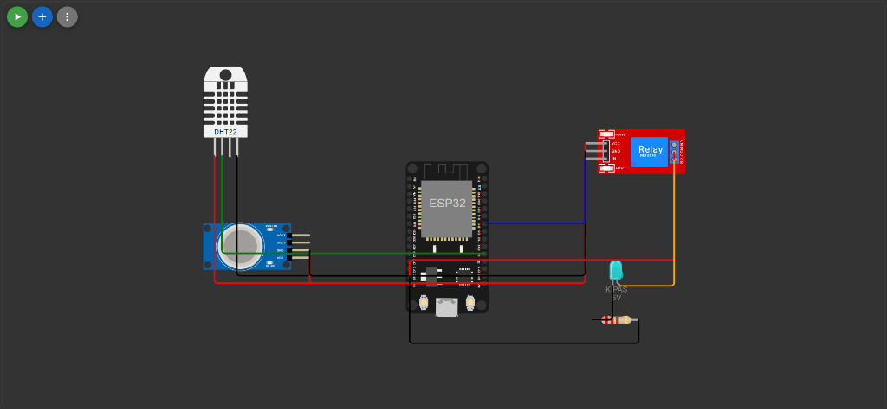

# Smart Cooling & Smoke Exhaust System ESP32 (DHT22 + MQ-135 + Relay 1 Channel)

Sistem pendingin cerdas dan evakuasi asap otomatis berbasis ESP32 menggunakan:
* Sensor Suhu & Kelembapan: DHT22 (GPIO 4)
* Sensor Kualitas Udara & Asap: MQ-135 (GPIO 34)
* Saklar Aktuator: Modul Relay 1 Channel (GPIO 18) mengendalikan Kipas Dinamo 5V / Exhaust Fan
* IoT & Remote: Web Dashboard (Port 80), Bot Telegram, Cloud MQTT (broker.emqx.io), dan Aplikasi Mobile Flutter

> Catatan Konfigurasi: Sistem ini menggunakan saklar RELAY murni (ON / OFF) tanpa driver MOSFET PWM, tanpa dioda flyback tambahan, dan tanpa buzzer alarm.

---

## Skema Perkabelan & Rangkaian Wokwi (Wiring Diagram)

| Komponen | Pin Komponen | Pin ESP32 | Keterangan |
| :--- | :--- | :--- | :--- |
| DHT22 | VCC | 3V3 | Daya sensor 3.3V |
| | GND | GND | Ground bersama |
| | SDA / Data | GPIO 4 | Sinyal data digital |
| MQ-135 | VCC | 3V3 / VIN | Daya sensor |
| | GND | GND | Ground bersama |
| | A0 (Analog) | GPIO 34 | Pembacaan ADC (0 - 4095) |
| Modul Relay | VCC | VIN (5V) | Daya koil relay |
| | GND | GND | Ground bersama |
| | IN | GPIO 18 | Sinyal kendali digital |
| Kipas Dinamo 5V | (+) Positif | COM (Relay) | Jalur daya kipas terputus saat relay mati |
| | (-) Negatif | GND | Ground bersama |
| Sumber Daya 5V | (+) 5V | NO (Relay) | Terhubung ke Kipas saat relay menyala |

---

## Cara Menjalankan di Wokwi

1. Buka project Wokwi menggunakan file diagram.json.
2. Pastikan file libraries.txt sudah terpasang.
3. Klik tombol Play untuk memulai simulasi.
4. Nilai sensor suhu DHT22 dan gas MQ-135 dapat diubah secara interaktif melalui antarmuka simulator.
